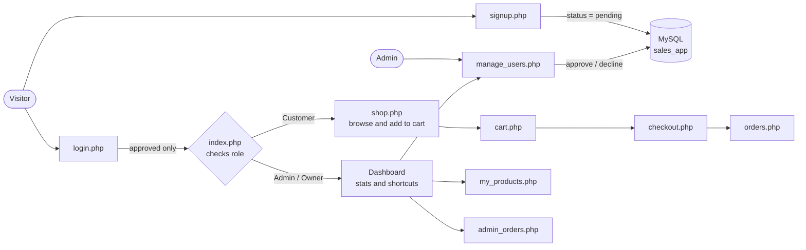
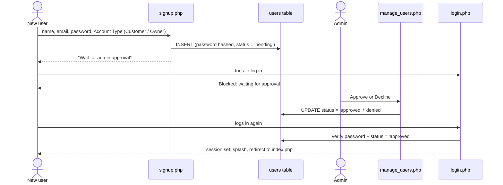
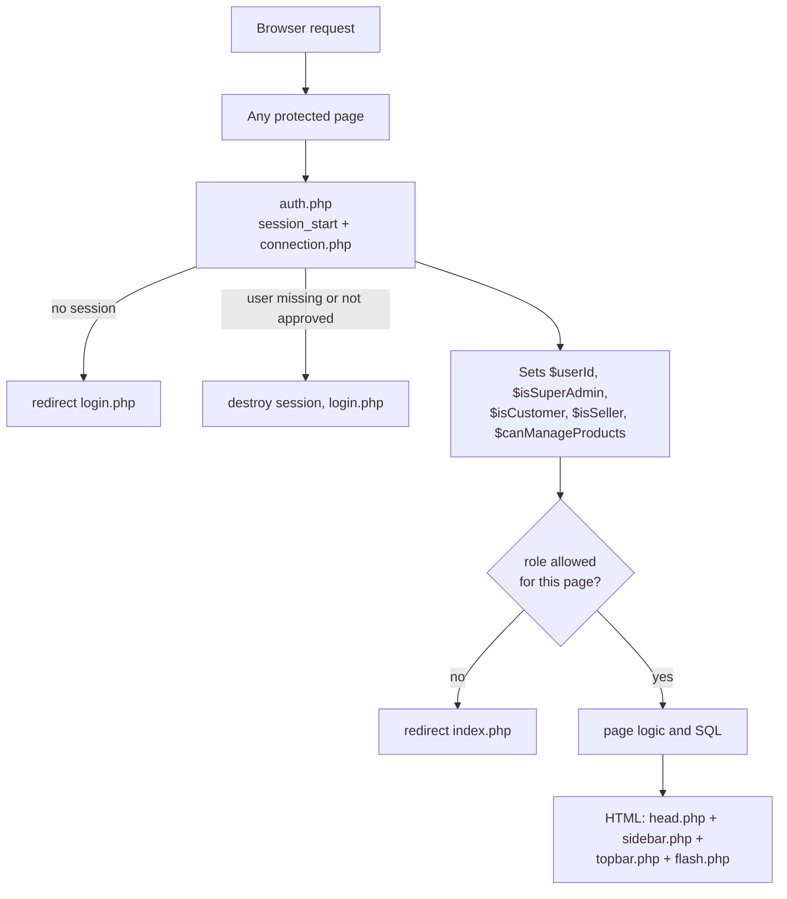
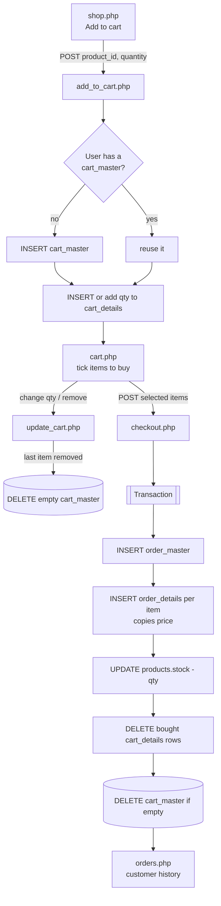
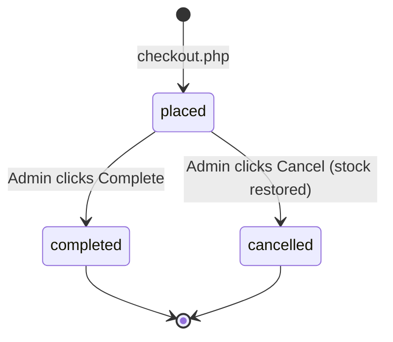
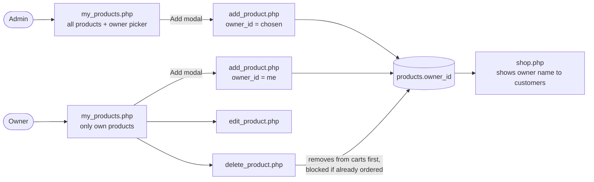
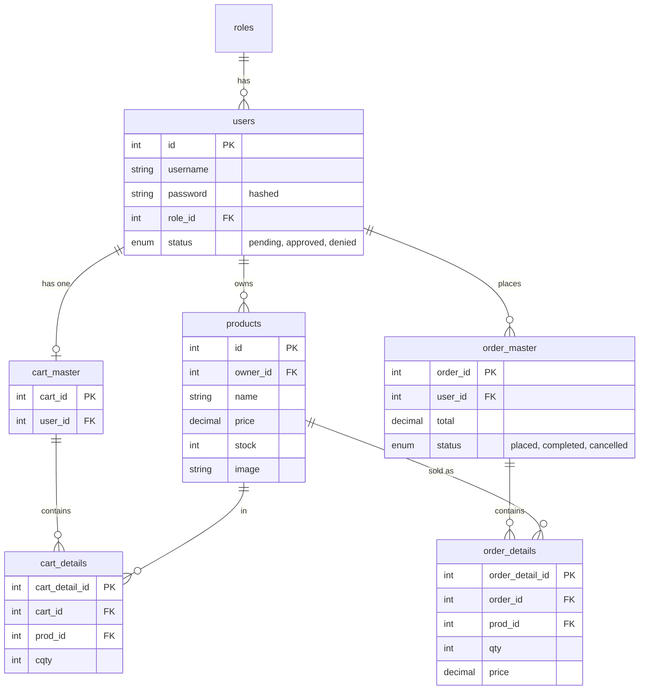
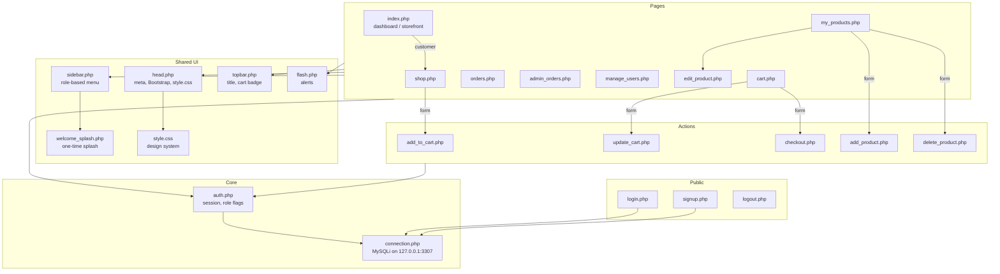

# Sales Manager – How the System Works

A PHP + MySQL (MySQLi, Bootstrap 5) sales system with three roles. This document explains the overall flow and how each file relates to the others. Diagrams are Mermaid and render on GitHub and in VS Code (Markdown Preview Mermaid support).

---

### DOWNLOAD DATABASE https://www.mediafire.com/file/d9gcug209o6m88d/sales_app+(1).sql/file
## 1. The big picture

## 2. Roles

| role_id | Role | Lands on `index.php` as | Can do |
|---|---|---|---|
| 1 | **Admin** | System dashboard | Everything: approve users, all products, all orders, complete/cancel orders |
| 2 | **Customer** | Product storefront (`shop.php`) | Browse, cart, checkout, view own orders |
| 3 | **Owner** | Own dashboard | Add/edit/delete **own** products, see orders that contain own products |

`index.php` is the single entry point: it includes `auth.php`, then `if ($isCustomer)` loads the storefront (`shop.php`), otherwise it renders the dashboard.

---

## 3. Registration and approval

`status` values: `pending` → `approved` or `denied`. `auth.php` re-checks this on every request, so an account that is declined later is logged out immediately.

---

## 4. Request lifecycle (what every page does)

---

## 5. Cart → order flow

Rules worth knowing:
- A user has **one** `cart_master`; it has **many** `cart_details`.
- When a cart has no items, its `cart_master` is deleted. The next add creates a new one with a new ID.
- Only the **selected** items are bought; the others stay in the cart.
- Stock is checked and decremented inside a transaction (it rolls back if stock changed).

### Order status

Handled in `admin_orders.php`.

---

## 6. Product ownership flow

Owner scoping is done in SQL (`WHERE p.owner_id = $userId`), so owners never see or edit other owners' products or orders.

---

## 7. Database

Notes: deleting a user cascades to their orders; a product that has been ordered cannot be deleted (`delete_product.php` shows a warning). Schema changes made during development are recorded in `migrate_order_master.sql`.

---

## 8. File map – who uses whom

### What each file does

| File | Purpose |
|---|---|
| `connection.php` | Opens the MySQLi connection (`sales_app`, port 3307). |
| `auth.php` | Session guard. Loads the user fresh from DB, blocks non-approved users, defines `$userId`, `$isSuperAdmin`, `$isCustomer`, `$isSeller`, `$canManageProducts`. |
| `login.php` | Verifies credentials (hashed, with upgrade of legacy plain-text), rejects pending/declined, sets session, shows splash, redirects to `index.php`. |
| `signup.php` | Registers a Customer or Owner with status `pending`. |
| `logout.php` | Clears the session and returns to login. |
| `index.php` | Role switch: customers get `shop.php`; admin/owner get the dashboard (stats, recent orders, pending approvals, low stock). |
| `shop.php` | Product catalog with search; customers add to cart, owners/admin get Manage links. |
| `cart.php` | Shows the user's cart; select items, change quantity, remove, go to checkout. |
| `add_to_cart.php` | Creates `cart_master` if needed, adds/merges a `cart_details` row, validates stock. |
| `update_cart.php` | Updates quantity or removes an item; deletes the empty `cart_master`. |
| `checkout.php` | Transaction: creates `order_master` + `order_details`, reduces stock, removes bought items. |
| `orders.php` | Customer's own order history. |
| `admin_orders.php` | All orders (owners see orders with their products); admin completes or cancels. |
| `my_products.php` | Product table with search and Add modal (owner: own items; admin: all items). |
| `add_product.php` / `edit_product.php` / `delete_product.php` | Product write actions with ownership checks and image upload validation. |
| `manage_users.php` | Admin only: approve, decline, change role, delete users. |
| `head.php`, `sidebar.php`, `topbar.php`, `flash.php`, `welcome_splash.php` | Shared layout pieces included by every page. |
| `style.css` | The design system: sidebar, cards, tables, animations, responsive rules. |
| `uploads/` | Uploaded product images (`placeholder.svg` is the fallback). |
| `migrate_order_master.sql` | Record of schema changes applied to the database. |

---

## 9. Conventions used by the pages

- Pages set `$pageTitle` and `$pageCrumb`, then include the shared layout files.
- Success and error messages are stored in `$_SESSION['flash']` and shown once by `flash.php` after a redirect.
- All writes happen in `POST`-only action files, which redirect back when done (Post/Redirect/Get).
- Queries use prepared statements; output is escaped with `htmlspecialchars`.

## 10. Running locally

1. Start **Apache** and **MySQL** in XAMPP (MySQL on port **3307**, or edit `connection.php`).
2. Import/create the `sales_app` database and apply `migrate_order_master.sql` if your schema is older.
3. Open `http://localhost/Sales_app/login.php`.
