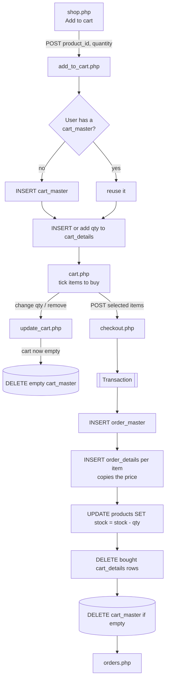
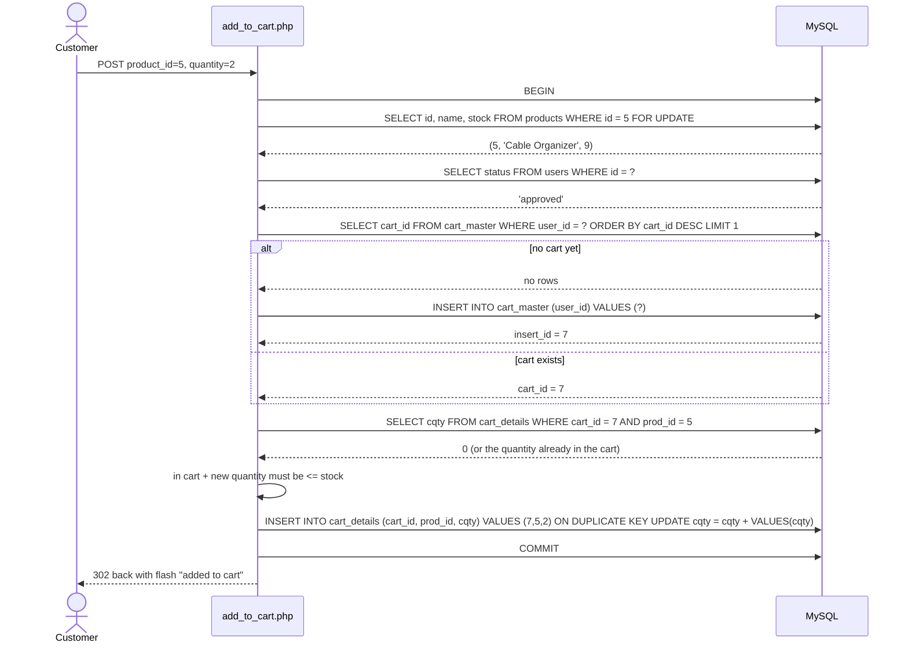
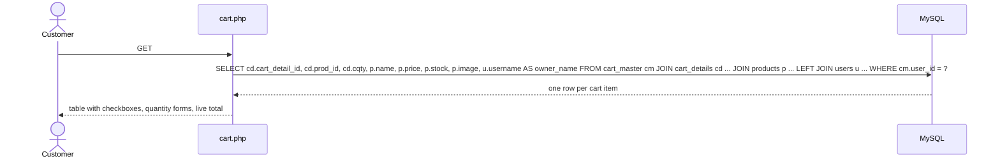
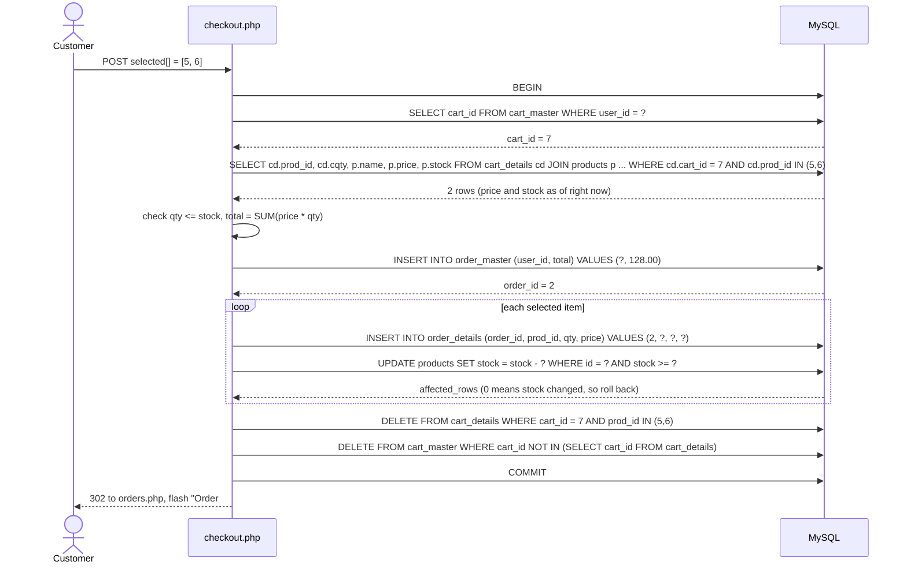
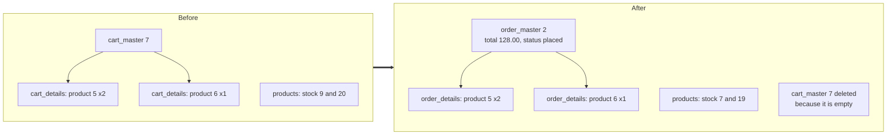
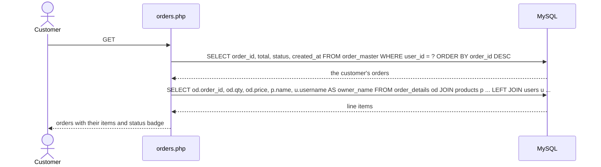

# Cart and Checkout

A user has **one** `cart_master`, and it has **many** `cart_details`. When the last item leaves the cart, the `cart_master` row is deleted; the next add creates a new one with a new ID.

## Overview

## 1. Add to cart (`add_to_cart.php`)

`cart_details` has a unique key on (`cart_id`, `prod_id`), so adding the same product twice increases the quantity instead of creating a second row.

## 2. View cart (`cart.php`)

Example result the page receives:

| cart_detail_id | prod_id | cqty | name | price | stock | owner_name |
|---|---|---|---|---|---|---|
| 12 | 5 | 2 | Cable Organizer | 5.00 | 9 | Sean |
| 13 | 6 | 1 | Pics | 123.00 | 20 | Sean |

## 3. Update or remove (`update_cart.php`)

| Action | SQL |
|---|---|
| Change quantity | `UPDATE cart_details SET cqty = ? WHERE cart_id = ? AND prod_id = ?` (after checking stock) |
| Remove item | `DELETE FROM cart_details WHERE cart_id = ? AND prod_id = ?` |
| Then, always | `DELETE FROM cart_master WHERE cart_id NOT IN (SELECT cart_id FROM cart_details)` |

## 4. Checkout (`checkout.php`)

Only the ticked items (`selected[]`) are bought. Everything runs in **one transaction**: if anything fails, nothing is saved.

### Before and after

`order_details.price` stores the price **at the time of purchase**, so later price edits do not change old orders.

## 5. Order history (`orders.php`)

