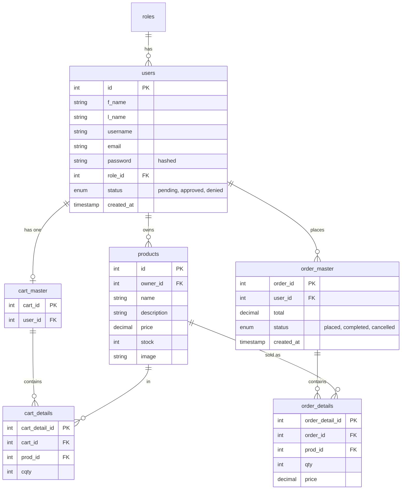
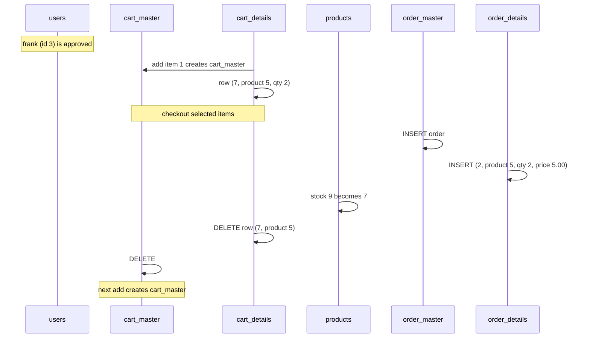

# Database

Database name: `sales_app` (MariaDB 10.4, port 3307).

## Relationships

## Roles

| id | Name |
|---|---|
| 1 | Admin |
| 2 | Customer |
| 3 | Owner (stored as "Seller" in the table, shown as "Owner") |

## Which file touches which table

C = insert, R = read, U = update, D = delete.

| File | users | products | cart_master | cart_details | order_master | order_details |
|---|---|---|---|---|---|---|
| `auth.php` | R | | | | | |
| `login.php` | R, U (password upgrade) | | | | | |
| `signup.php` | C | | | | | |
| `manage_users.php` | R, U, D | | | | | |
| `index.php` (dashboard) | R | R | | | R | R |
| `shop.php` | R | R | | | | |
| `add_to_cart.php` | R | R | C, R | C, U, R | | |
| `cart.php` | R | R | R | R | | |
| `update_cart.php` | | R | R, D | U, D | | |
| `checkout.php` | | R, U (stock) | R, D | R, D | C | C |
| `orders.php` | R | R | | | R | R |
| `admin_orders.php` | R | U (restore stock) | | | R, U | R |
| `my_products.php` | R | R | | | | R |
| `add_product.php` | R | C | | | | |
| `edit_product.php` | R | R, U | | | | |
| `delete_product.php` | | R, D | D | D | | R |
| `topbar.php` | | | R | R | | |

## Foreign key behaviour

| Relation | On delete |
|---|---|
| `products.owner_id` to `users` | `SET NULL`: product stays, owner shown as unknown |
| `order_master.user_id` to `users` | `CASCADE`: deleting a user deletes their orders |
| `order_details.prod_id` to `products` | no cascade: an ordered product cannot be deleted |
| `cart_details.cart_id` to `cart_master` | cart items belong to one cart |

## Data lifecycle example

Schema changes made during development are recorded in `migrate_order_master.sql` in the project root.
