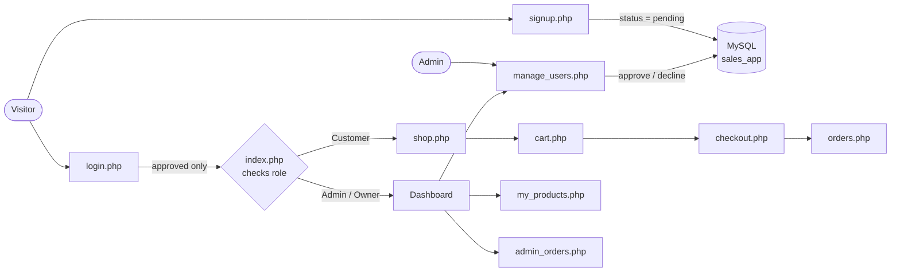
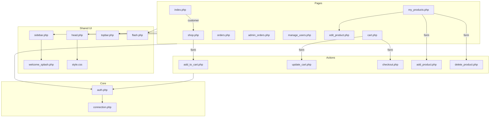

# Sales Manager Wiki

A PHP + MySQL (MySQLi, Bootstrap 5) sales system with three roles. This wiki shows **how a browser request travels through the PHP files, what SQL runs, and what the database sends back**.

## Pages

| Page | What you will learn |
|---|---|
| [Request and Response Lifecycle](Request-and-Response-Lifecycle) | What happens on every single page load |
| [Signup, Approval and Login](Signup-Approval-and-Login) | Registration, admin approval, session creation |
| [Cart and Checkout](Cart-and-Checkout) | Cart master/details, buying, stock, order creation |
| [Products and Orders](Products-and-Orders) | Owner/admin product management and order handling |
| [Database](Database) | Tables, relations, and which file reads or writes each table |

## Roles at a glance

| role_id | Role | `index.php` shows |
|---|---|---|
| 1 | Admin | System dashboard |
| 2 | Customer | Product storefront (`shop.php`) |
| 3 | Owner | Own dashboard (own products and orders only) |

## The whole system in one picture

## File map: who includes whom

## Conventions

- Pages set `$pageTitle` / `$pageCrumb`, then include the shared layout files.
- Messages are stored in `$_SESSION['flash']` and shown once by `flash.php`.
- Writes happen in POST-only action files that redirect back afterwards (Post/Redirect/Get).
- Queries use prepared statements; output is escaped with `htmlspecialchars`.

## Running locally

1. Start **Apache** and **MySQL** in XAMPP (MySQL on port **3307**, or edit `connection.php`).
2. Create the `sales_app` database and apply `migrate_order_master.sql` if your schema is older.
3. Open `http://localhost/Sales_app/login.php`.
