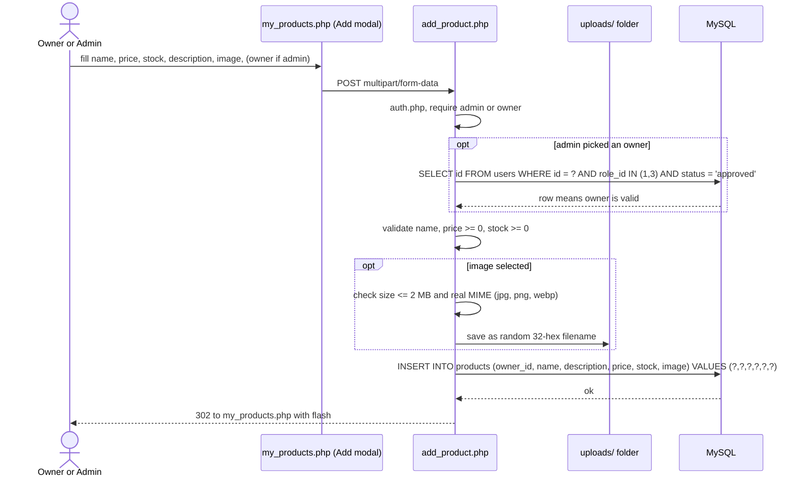
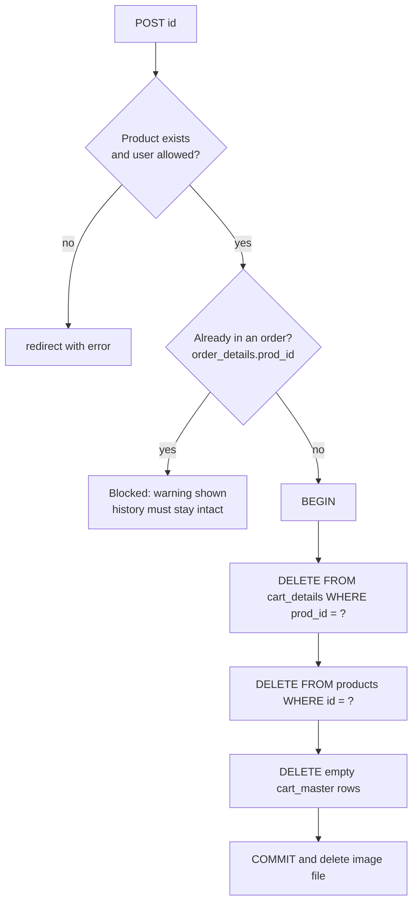
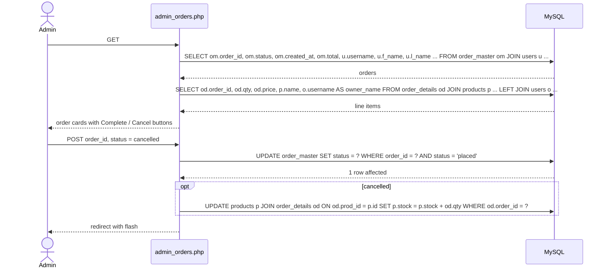
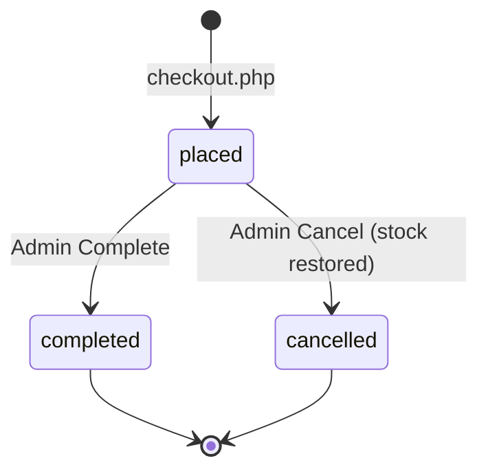

# Products and Orders

## Who can do what

| Action | Admin | Owner | Customer |
|---|---|---|---|
| See all products (`my_products.php`) | Yes | Only own | No |
| Add product | Yes, pick any owner | Yes, owner is themselves | No |
| Edit / delete product | Any | Only own | No |
| See orders (`admin_orders.php`) | All | Only those containing own products | No (uses `orders.php`) |
| Complete / cancel an order | Yes | No | No |

Owner scoping is done in SQL with `WHERE p.owner_id = <user id>`, so an owner never receives another owner's rows.

## Add a product

## Edit a product (`edit_product.php`)

1. `SELECT id, owner_id, name, description, price, stock, image FROM products WHERE id = ?`
2. Owner check: an owner whose ID is not `owner_id` is redirected away.
3. On save: `UPDATE products SET owner_id, name, description, price, stock[, image] WHERE id = ?`

## Delete a product (`delete_product.php`)

## Admin and owner order handling

The `AND status = 'placed'` guard means an order can only change once. Double clicking Cancel cannot restore stock twice.

## Dashboard data (`index.php` for admin/owner)

| Card | Source |
|---|---|
| Users, Pending (admin) | `COUNT(*)` on `users`, and where `status = 'pending'` |
| Products | `COUNT(*)` on `products` (owner: where `owner_id = me`) |
| Orders, Revenue | `order_master` / `order_details` totals (owner: only lines of own products) |
| Recent orders | latest rows of `order_master` joined with `users` |
| Pending approvals | `users` where `status = 'pending'`, with Approve / Decline buttons |
| Low stock | `products` where `stock <= 5` |
