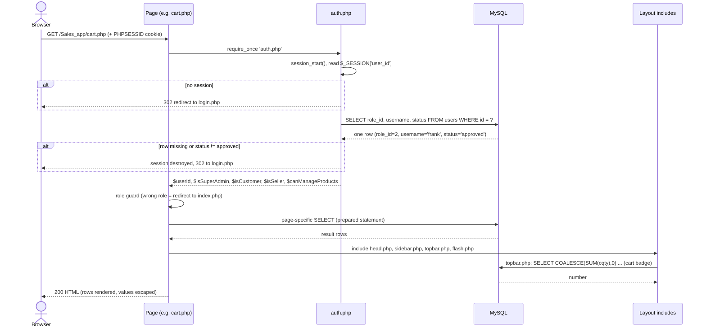
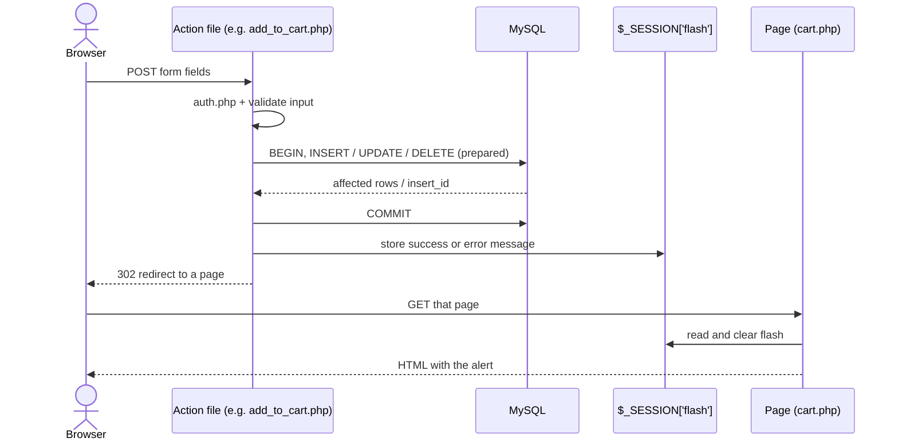

# Request and Response Lifecycle

Every protected page follows the same path. Understanding this once explains the whole app.

## Page load (GET)

Key point: the role is **re-read from the database on every request**. If an admin declines or changes a user, it takes effect on that user's next click.

## Form submit (POST, then redirect)

This is the **Post/Redirect/Get** pattern: refreshing the page never re-submits the form.

## Shared files in each request

| Step | File | Role |
|---|---|---|
| 1 | `connection.php` | Opens the MySQLi connection (`127.0.0.1:3307`, db `sales_app`) |
| 2 | `auth.php` | Session guard, user lookup, role flags |
| 3 | page file | Guard, queries, builds data |
| 4 | `head.php` | `<head>`, Bootstrap, `style.css` (versioned by file time) |
| 5 | `sidebar.php` | Role-based menu; includes `welcome_splash.php` |
| 6 | `topbar.php` | Title, breadcrumb, cart count |
| 7 | `flash.php` | One-time alert from the session |
