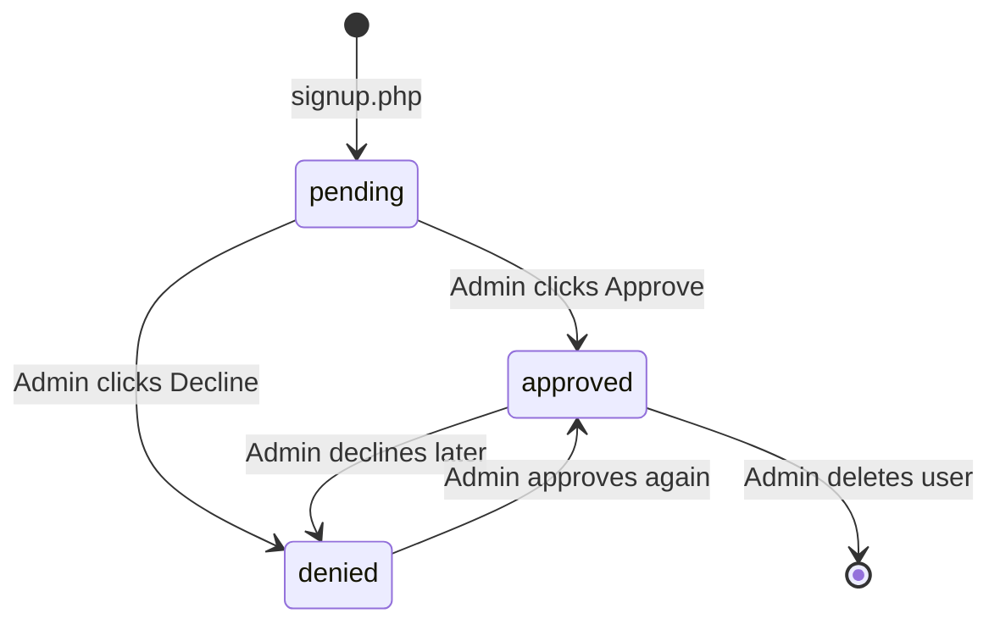
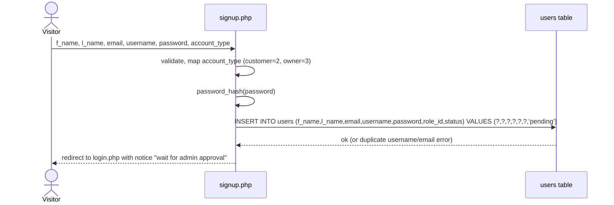
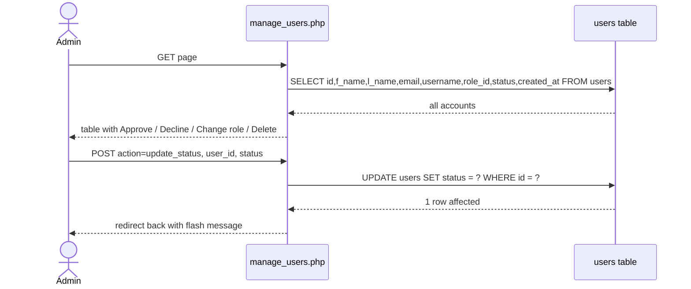
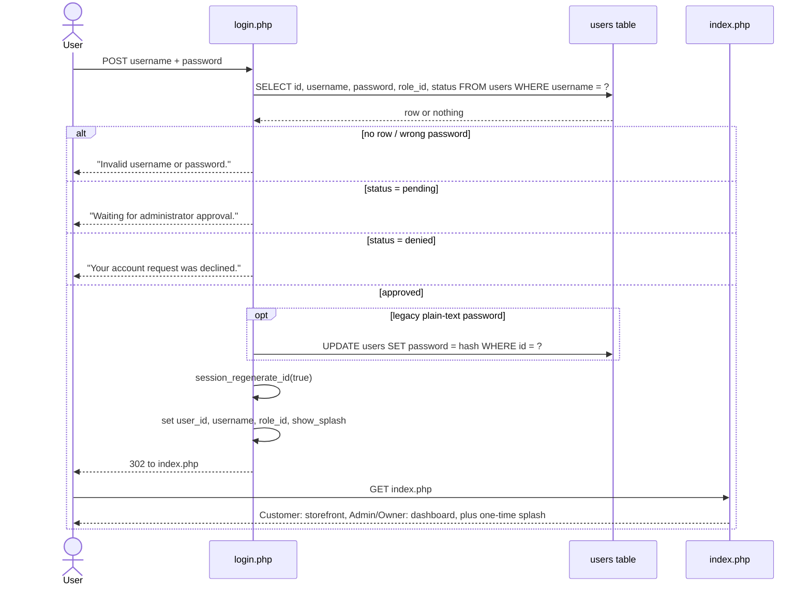
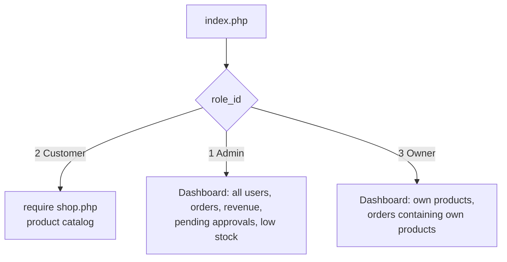

# Signup, Approval and Login

## States of an account

## 1. Signup

## 2. Admin approval

Other actions on the same file: `change_role` runs `UPDATE users SET role_id = ?`, and `delete_user` runs `DELETE FROM users WHERE id = ?` (an admin cannot delete themselves).

## 3. Login

## Who sees what after login

## Logout

`logout.php` empties `$_SESSION`, expires the cookie, destroys the session and redirects to `login.php`.
